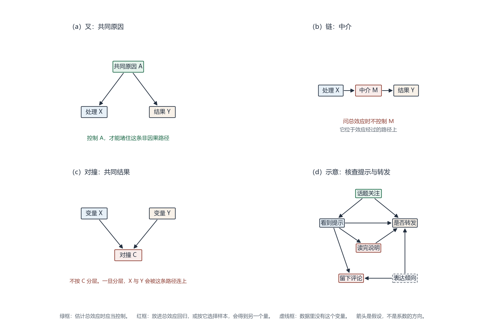

# 结构因果模型与因果图（Structural Causal Model / Causal Graph）

**提出者：** Judea Pearl；Sander Greenland、James M. Robins 等把因果图写进经验研究
**关键词：** 有向无环图、干预、后门准则、好控制与坏控制

**词条序号：** 96
**姓名：** 朱子健
**学号：** 202413093028

## 一、定义

结构因果模型用一组结构方程描述变量怎样生成。每个内生变量由其原因和一个不被图中其他变量决定的扰动项赋值；把赋值关系画成有向无环图，箭头从原因指向结果，就得到因果图。图上没有箭头，表示在这组假设里不存在对应的直接影响。箭头写的是生成方向，不能按代数把方程左右对调。[1]

这个框架要回答的不是“两个变量相关有多强”，而是另一件更靠前的事：如果按领域知识把影响关系画清楚，那么为了估计某个干预的效应，回归里该放进哪些变量，又不该放进哪些变量。图一旦写下，就可以查询现有假设够不够把效应从观测分布里识别出来；够，就给出相应的公式；不够，就说明还缺哪一类变量或实验。[2]

通俗地说，因果图是一张“谁影响谁”的假设图。回归系数本身不会告诉你这张图应当怎样画。

## 二、背景和上下文

用箭头表示原因，在路径分析里早有传统。1995 年 Pearl 在 *Biometrika* 给出一套非参数的图准则，用来判断非实验数据能否识别因果效应，其中最常用的是后门准则。[2] 1999 年 Greenland、Pearl 与 Robins 把这套语言写给经验研究者：图可以指出必须测量并控制的变量，也能揭示传统混杂准则在同时考虑多个协变量时会在哪里失手。[3]

新闻与舆情研究几乎总是面对观测到的日志，研究者又容易在回归里放入尽可能多的变量。看到核查提示的人与没看到的人转发率不同，这只是一条条件关联。关注该话题的人既更容易点开提示，也更愿意转发，这条共同原因会让关联偏离效应。与此同时，把“是否读完说明”“是否留言”一并放进模型，又会放进不该放的变量。Cinelli、Forney 与 Pearl 把后一种问题称为坏控制：多加一个变量之后，回归系数不再等于研究者想要的那个效应。[4]

使用边界也来自这里。图表达的是假设，不是数据自己长出来的结构。在因果马尔可夫条件和忠诚性等额外假设下，观测到的独立关系至多把候选图缩小到一个等价类；类中的图共享同一套独立关系，一部分箭头方向仍然定不下来。因此，不能把算法输出的一张图当成已经查明的因果结构。[5]

## 三、举例说明

**示意情境（非实测数据）：** 平台给一条未经证实的帖子加上核查提示。研究者想估计“看到这条提示”对“是否转发”的总效应，手里只有用户日志。

把领域判断画成图 1（d）。话题关注会让人更可能看到提示，也会让人更愿意转发，所以它是共同原因。从“看到提示”沿箭头反向走到“话题关注”，再走到“转发”，这是一条后门路径。读完说明位于提示和转发之间：提示可以因为被人读完而改变转发，也可以不经过阅读直接改变转发。前一条是中介路径，属于总效应的一部分。留下评论则是对撞点。看到提示，以及另一种没有进入日志的表达倾向，都会促成留言；表达倾向自己也会推动转发。只保留留言用户，等于按这个对撞点选择了样本。

在这张图下，估计总效应时应当控制话题关注，不应当控制“读完说明”，也不应当把样本限制在留言者。控制话题关注之后，总效应可以写成对关注程度的标准化。设转发为 $Y$，看到提示为 $X$，话题关注为 $A$，且 $A$ 只取有限个水平，则

$$P(Y=y \mid do(X=x)) = \sum_a P(Y=y \mid X=x, A=a)\, P(A=a)$$

$do(X=x)$ 表示干预：不论这个人原本会不会点开，都使其处于“看到提示”或“没看到提示”的状态。公式右边仍是观测概率，左边才是干预下的转发分布。它能够成立，是因为话题关注挡住了那条指向处理的非因果路径，而且调整变量本身不是处理的结果。[2][4] 若关注程度是连续的，求和换成积分，结构不变。某个关注水平上如果根本没有人看到提示，条件概率就没有观测对象，公式同样写不出来。

三种基本结构见图 1 的前三格。叉是共同原因，要控制；链是中介，问总效应时不控制；对撞在未分层时本身是堵住的，按它分层反而会把两端连上。

图 1. 前三格是判断一个变量该不该放进总效应回归的三种基本结构。第四格是上文的示意：话题关注是共同原因；“看到提示”到“是否转发”的上边是直接路径，下边经过“读完说明”；留下评论是看到提示与未观测的表达倾向的共同结果。箭头表示假设中的直接影响。

## 四、对比分析

| 对比对象 | 它关心的问题 | 与本框架的关系 |
| --- | --- | --- |
| 潜在结果框架（词条 95） | 同一个体接受干预与否，两种结果相差多少 | 效应仍按潜在结果来定义。因果图用来判断哪些变量使“可忽略性”变得可信，并写出调整公式 |
| 多元回归 | 放进若干变量之后，处理系数是多少 | 系数是条件关联。只有控制集满足相应的图准则，而且研究者问的正是图所对应的那个效应时，系数才可以解释为因果效应 |
| 预测模型 | 新样本的转发能否预测得准 | 预测得准，只说明变量之间有可利用的关联，不说明强制加上或拿掉核查提示之后转发会如何变化 |
| 因果发现 | 观测到的独立关系与哪一类图相容 | 算法在额外假设下输出的是等价类，不是一张被数据唯一确定的因果图 |

相关有多强、预测准不准、干预效应是多少，这是三件不同的事。图的作用是把第三件事所依赖的假设摆到桌面上。Imbens 比较了潜在结果传统和有向无环图传统，指出两边善于处理的问题并不相同；就本词条的任务而言，图负责“控制什么”，潜在结果负责“效应是什么”。[6] 这一分工与词条 95 的对照一致。

## 五、深入扩展

结构方程写的是生成过程，不是一条可以随意移项的回归。沿用上一节的例子，设话题关注为 $A$，看到提示为 $X$，读完说明为 $M$，转发为 $Y$，未观测的表达倾向为 $U$，其余扰动写在相应的下标里：

$$X := f_X(A, U_X), \quad M := f_M(X, U_M), \quad Y := f_Y(X, M, A, U, U_Y)$$

$:=$ 表示右边生成左边。干预 $do(X=x)$ 是删去 $X$ 自己的方程，改成 $X := x$，其他方程保持不变。[1] 因此，干预分布和“在恰好看到提示的人里面观察转发”不是同一个分布。后者仍然带着“什么样的人会看到提示”这层选择。

后门准则给出一组足够的条件，用来判断调整是否合法。相对有序变量对 $(X,Y)$，一组变量 $Z$ 满足后门准则，如果 $Z$ 里没有 $X$ 的后代，并且 $Z$ 挡住每一条两端连接 $X$ 与 $Y$、且有箭头指向 $X$ 的路径。满足时，上一节的标准化公式把干预分布还原成观测分布。[2] 这是一条足够条件，不是唯一的识别路线。混杂无法测量时，有时还可以使用前门准则，那需要另一组更强的结构假设，本例用不上。准则明确排除的是处理的后代，所以“读完说明”不能为了总效应放进调整集：它位于处理之后，挡住的是因果路径，而不是后门。

坏控制常见有两种样子，而且不能按“处理之前全控制、处理之后全不控制”来记。一种是过度控制中介。看到提示之所以改变转发，有一部分是因为有人读完了说明。把“读完说明”放进回归，系数回答的就不再是总效应。若研究者改问直接效应，控制中介还会遇到中介与结局之间的未测量混杂，不能把总效应模型里多放一个变量当成直接效应的解法。[4] 另一种是条件化对撞。Hernán、Hernández-Díaz 与 Robins 指出，许多选择偏倚共享同一结构：条件化于某个共同结果，而这个结果的两个原因分别连着处理与结局。[7] Elwert 与 Winship 在社会学里把这种现象称为内生选择偏倚。[8] 留言就是这种共同结果。表达倾向没有进入数据时，只保留留言用户，会让“没看到提示却留了言”的人在表达倾向上更高，他们的转发率因此被抬高，比较就偏了。处理之前的变量也不自动安全。有些处理前的变量本身是对撞点，放进回归会打开原本堵住的路径。Cinelli 等人讨论的，正是这类不能靠“变量越多越好”解决的情形。[4]

相关也恢复不出唯一的图。因果马尔可夫条件说的是：若这张图是对的，那么图上被分离开的变量，在观测分布里应当条件独立。从独立关系反推箭头，还需要忠诚性等假设；即便这些假设成立，通常得到的仍是一个马尔可夫等价类，其中部分箭头可以反向而不改变独立关系。[5] 所以，先写出图，再说明箭头依据的是时序、机制还是设计，这是使用这个框架的方式。用相关系数的正负去决定箭头方向，不是。

文本协变量在舆情数据里尤其容易放错位置。混杂常常埋在历史帖文和新闻正文里。Keith、Jensen 与 O'Connor 综述了用文本测量混杂、再把它从因果估计中剥离的做法，同时也列出测量误差和评估上尚未解决的问题。[9] 用户看到提示之前写下的文本，有时可以作为话题关注的代理；看到提示之后才写下的评论，则是处理的后代。把后一种文本当作“又一个控制变量”放进回归，位置就放反了。文本能够帮助测量混杂，并不表示任何一段文本都应当被控制。

## 六、简明总结

1. 结构因果模型用结构方程生成变量，因果图把“谁影响谁”的假设画成有向无环图。
2. 估计总效应时，控制共同原因；不控制中介；也不要按处理与结局的共同结果去选择样本。处理前的变量若是对撞点，同样不能放进回归。
3. 后门调整把干预分布写成观测概率的标准化。公式是否成立取决于图，不取决于回归是否显著。
4. 图是假设。相关至多区分一个等价类，不能自动生成一张可靠的因果结构。

## 参考资料

[1] Pearl, J. (2009). *Causality: Models, Reasoning, and Inference* (2nd ed.). Cambridge: Cambridge University Press.

[2] Pearl, J. (1995). Causal diagrams for empirical research. *Biometrika*, 82(4), 669–688. https://doi.org/10.1093/biomet/82.4.669

[3] Greenland, S., Pearl, J., & Robins, J. M. (1999). Causal diagrams for epidemiologic research. *Epidemiology*, 10(1), 37–48. https://doi.org/10.1097/00001648-199901000-00008

[4] Cinelli, C., Forney, A., & Pearl, J. (2024). A crash course in good and bad controls. *Sociological Methods & Research*, 53(3), 1071–1104. https://doi.org/10.1177/00491241221099552 （2022 年在线发表）

[5] Spirtes, P., Glymour, C., & Scheines, R. (2000). *Causation, Prediction, and Search* (2nd ed.). Cambridge, MA: MIT Press.

[6] Imbens, G. W. (2020). Potential outcome and directed acyclic graph approaches to causality: Relevance for empirical practice in economics. *Journal of Economic Literature*, 58(4), 1129–1179. https://doi.org/10.1257/jel.20191597

[7] Hernán, M. A., Hernández-Díaz, S., & Robins, J. M. (2004). A structural approach to selection bias. *Epidemiology*, 15(5), 615–625. https://doi.org/10.1097/01.ede.0000135174.63482.43

[8] Elwert, F., & Winship, C. (2014). Endogenous selection bias: The problem of conditioning on a collider variable. *Annual Review of Sociology*, 40, 31–53. https://doi.org/10.1146/annurev-soc-071913-043455

[9] Keith, K. A., Jensen, D., & O'Connor, B. (2020). Text and causal inference: A review of using text to remove confounding from causal estimates. In *Proceedings of the 58th Annual Meeting of the Association for Computational Linguistics* (pp. 5332–5344). https://doi.org/10.18653/v1/2020.acl-main.474
